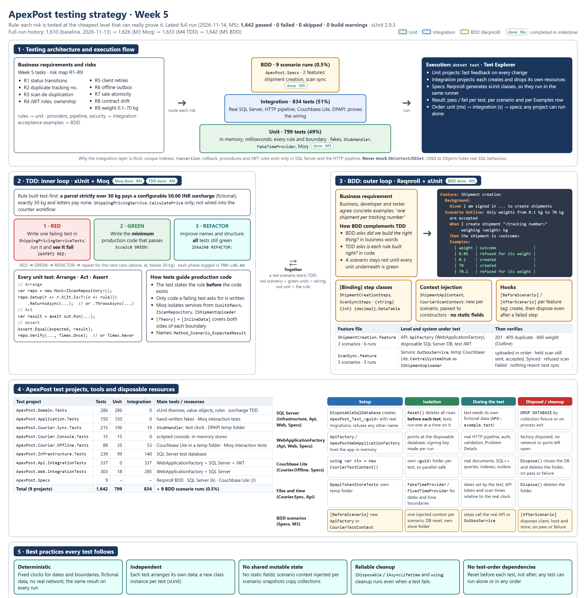

# ApexPost testing strategy (Week 5)

**Rule: each risk is tested at the cheapest level that can really prove it.** Written before any new Week 5 test (Task 1). "Existing" means it is in the repository and passed in the fresh run of 2026-11-13 at commit `684470c`: **1,610 passed, 0 failed, 0 skipped**, build with 0 warnings. "Planned" shows the milestone (M6–M7). After the Moq tests of M3, the full run of 2026-11-14 (10:36–10:38 UTC) passed **1,626 of 1,626**, with 0 failed, 0 skipped and 0 build warnings. After the TDD work of M4, the full run of 2026-11-14 (11:03–11:04 UTC), on the code committed as `256a248`, gave **1,633 passed, 0 failed, 0 skipped, 0 build warnings**. **Latest:** after the BDD scenarios of M5, the full run of 2026-11-14 (11:31–11:33 UTC) gave **1,642 passed, 0 failed, 0 skipped, 0 build warnings**.

## 1. Scope and risks

**In scope:** domain and application services, validation, repositories (integration level), the Web API, the typed client `ApexPost.Courier.Sync` and the Couchbase Lite outbox `ApexPost.Courier.Offline`. **Out of scope:** UI pages, browser testing and MAUI (the courier client is a console).

| # | Risk | Existing evidence | Week 5 |
|---|---|---|---|
| R1 | Invalid status transitions | `ShipmentStatusTransitionRuleTests` (all 36 pairs), `ShipmentStatusTests` | Moq: `TrackedShipmentApplicationServiceTests` (done, M3) |
| R2 | Duplicate tracking numbers | `ShipmentEndpointsTests` (409, keeps the first) | `ShipmentCreation.feature` (done, M5) |
| R3 | Duplicate scans | `ScanUploadTests`, `CourierClientRetryTests` | `ScanSync.feature` (done, M5) |
| R4 | JWT roles and courier ownership | `SecurityTests` | Kept |
| R5 | Client retries | `ResilienceTests`, `ApexApiClientTests` | Kept |
| R6 | Offline outbox loses scans | `OutboxServiceTests`, `CourierOfflineSyncTests` | Moq: `OutboxServiceInteractionTests` (done, M3) |
| R7 | Sale atomicity and stock | `SaleRollbackTests`, `TransactionsControllerTests` | Kept |
| R8 | Published contract drift | `PublishedContractTests`, `ApiVersioningTests` | Kept |
| R9 | Weight limits (0.1–70 kg) | `ShipmentEndpointsTests`, `WeightTests` | Heavy-parcel surcharge by TDD (done, M4; `TDD-LOG.md`); weight Scenario Outline in `ShipmentCreation.feature` (done, M5) |

## 2. Test architecture and projects

| Test project | Tests | Unit | Integration | Main tools / resources |
|---|---:|---:|---:|---|
| `ApexPost.Domain.Tests` | 286 | 286 | 0 | xUnit theories over rules and value objects; heavy-parcel surcharge tests (TDD) |
| `ApexPost.Application.Tests` | 150 | 150 | 0 | Hand-written fakes; Moq (`TrackedShipmentApplicationServiceTests`) |
| `ApexPost.Courier.Sync.Tests` | 215 | 196 | 19 | `StubHandler`, test clock; DPAPI temp folder |
| `ApexPost.Courier.Console.Tests` | 15 | 15 | 0 | Scripted console, in-memory stores |
| `ApexPost.Courier.Offline.Tests` | 88 | 35 | 53 | Couchbase Lite in a temp folder; Moq (`OutboxServiceInteractionTests`) |
| `ApexPost.Infrastructure.Tests` | 239 | 99 | 140 | SQL Server test database |
| `ApexPost.Api.IntegrationTests` | 337 | 0 | 337 | `WebApplicationFactory` + SQL Server + test JWT |
| `ApexPost.Web.IntegrationTests` | 303 | 18 | 285 | `WebApplicationFactory` + SQL Server |
| `ApexPost.Specs` | 9 | – | – | Reqnroll BDD: 6 API scenario runs (SQL Server), 3 outbox scenarios (Couchbase Lite) |
| **Total** | **1,642** | **799 (49%)** | **834 (51%)** | plus **9 BDD scenario runs (0.5%)** |

- **Unit:** in memory, milliseconds; every rule and boundary. **Integration:** proves the wiring. Unique indexes, `rowversion`, rollback, procedures and JWT rules exist only in SQL Server and the HTTP pipeline, so this layer is thick on purpose. **BDD:** a few business scenarios on top.
- **Framework:** xUnit 2.9.3 everywhere. A new class instance per test, `IDisposable`/`IAsyncLifetime` for setup and teardown, `[Theory]` + `[InlineData]` for boundaries. Reqnroll generates xUnit classes, so all levels run in `dotnet test` and Test Explorer.
- **Conventions:** `Method_Scenario_ExpectedResult`; Arrange, Act, Assert; exact exception types; both sides of each boundary; fictional data only (`APX-`, `example.test`); no secrets.
- **Data access:** never mock `DbContext`/`DbSet` (LINQ to Objects hides SQL translation, constraints and transactions); EF Core InMemory and SQLite are not used. Every Moq-tested decision also has an integration test against the real provider.
- **Review of existing tests:** all 108 classes were reviewed and none is removed. Three classes were **modified in M2**:
  - `SqlScriptTests` (three tests) and `DailySalesReportsControllerTests.Dashboard_ShowsTodaysSalesRoundedLikeTheDailySalesReport` took "today" from `DateTime.UtcNow`, so a run crossing midnight UTC could fail. They now use a `FixedTimeProvider` (`tests/Shared/FixedTimeProvider.cs`) on a fixed business date.
  - `StaffPasswordHashingTests.DummyVerification_TakesAboutAsLongAsARealCheck` compared wall-clock timings, so its result depended on machine load. It is replaced by `DummyCredential_HasTheSameWorkFactorAsACreatedCredential`, which checks the same timing-attack guard deterministically. `PerformDummyVerification` now runs `Verify` against an internal `DummyCredential`, so the unknown-account path does the same work as a real check. A break-and-restore check confirmed the new test fails when the dummy work factor changes.

## 3. TDD: the inner loop (M3 Moq, M4 TDD)

**RED:** write one failing test and see it fail. **GREEN:** write the minimum code that passes. **REFACTOR:** improve the structure while all tests stay green. Repeat for the next case. Each phase is its own commit (`RED:`, `GREEN:`, `REFACTOR:`) and is recorded in `TDD-LOG.md`.

- **TDD (done, M4).** Evidence: [TDD-LOG.md](TDD-LOG.md) and three separate commits:
  - `264f8f2` RED: add heavy parcel surcharge pricing tests;
  - `5cce2c8` GREEN: implement heavy parcel surcharge pricing;
  - `256a248` REFACTOR: improve heavy parcel pricing clarity.
- **Rule:** a **parcel** strictly over 30 kg pays a heavy-parcel surcharge in `ShippingPricingService.CalculatePrice`.
  - **No surcharge:** exactly 30 kg and below, and letters of any weight.
  - **Amount:** a fictional **50.00 INR**. It is configurable, not hard-coded: it is passed to the service's constructor as `heavyParcelSurcharge`, because ADR 0005 treats prices as configured policy.
  - **Errors:** a parcel over 30 kg with no configured surcharge fails closed (`InvalidOperationException`), as a missing rate does. A surcharge in a different currency from the rate is rejected.
- **Tests:** 7 new cases in `ShippingPricingServiceTests`: 30 kg, 29.99 kg, 30.01 kg and 31 kg, no surcharge configured, a USD surcharge, and a 31 kg letter. The 7 original pricing tests are unchanged.
- **Scope:** the rule is implemented only in the domain pricing service. The counter workflow (`MixedBasketApplicationService`) and the application configuration are **not wired**, so no surcharge is configured in the running application. Until it is, a counter sale of a parcel over 30 kg is refused rather than priced without its surcharge; this matters only where a parcel weight limit above 30 kg is configured.
- **Moq (done, M3)** isolates two services with `Mock<T>`, `Setup`/`Returns`/`ReturnsAsync`/`ThrowsAsync`/`SetupSequence`, `It.Is`/`It.IsAny`, and `Verify` with `Times.Once`/`Times.Never`/`Times.Exactly`:
  - **Interface naming:** the assignment's `IShipmentRepository` is this solution's `ITrackedShipmentRepository` (`src/ApexPost.Application/Persistence/ITrackedShipmentRepository.cs`), the shipment repository of the Week 4 API. Its SQL Server implementation is `SqlTrackedShipmentRepository`. No `IShipmentRepository` exists, and the interface is not renamed, because its name is already used by the service, the implementation and the dependency registration.
  - `TrackedShipmentApplicationServiceTests` (10 tests) mocks `ITrackedShipmentRepository` and `IUnitOfWork`. The `ExecuteInTransactionAsync` mock runs the use case it is given, as the real unit of work does. Covered: create saves once; a `DuplicateRecordException` becomes a conflict (R2); an allowed status change saves; Delivered → InTransit, an unknown tracking number, and deleting a PickedUp shipment save nothing (R1); a repeated scan is stored once, a scan held by another shipment is rejected, and a duplicate on save reruns the upload once on fresh state (R3).
  - `OutboxServiceInteractionTests` (6 tests) mocks `IScanRepository` and `IShipmentUploader`. Covered: Synced and Failed are written back per scan; 25 scans go as batches of 20 and 5; an uploader exception or a RetryLater stops the run with no status change for unanswered scans (R6); nothing pending or an already cancelled run never calls the uploader.
  - **What they do not prove:** the SQL, unique keys, transactions and Couchbase Lite storage behind the mocked interfaces. Those are covered by `SqlPersistenceTests`, the API integration tests and `OutboxServiceTests`.
  - **Proof that they can fail:** each class was checked by break-and-restore. A service that saved after accepting no scans failed 2 of the 10 tests, and an outbox that kept sending batches after a missing answer failed 2 of the 6 tests.
- **How the tests guide the code:** the test states the rule before the code exists; only code a failing test asks for is written; later changes are checked against every earlier rule.

## 4. BDD: the outer loop (M5)

**Done (M5).** The business, a developer and a tester agree concrete examples first. These are written as **Given → When → Then** in feature files, with a `Background` per feature.

**Project:** `tests/ApexPost.Specs`, using Reqnroll 3.3.4 with `Reqnroll.xUnit` and xUnit 2.9.3. Reqnroll generates an xUnit class for each feature at build time, so the scenarios run in `dotnet test` and Test Explorer like every other test. The project links the existing test infrastructure instead of copying it: `DisposableSqlDatabase`, `ApiTestHost.cs` (`ApiFactory`, `TestTokens`) and the Couchbase Lite `TestSupport.cs`. No production code was changed.

| Feature | Level and system under test | Scenarios |
|---|---|---|
| `Features/ShipmentCreation.feature` | API: `ApiFactory` (`WebApplicationFactory`) on the disposable `ApexPost_Test_*` SQL Server database, signed in with an Admin test JWT | A valid shipment is created (201, Location, stored as Created); a tracking number cannot be used twice (409, the first is kept); **Scenario Outline** "Only weights from 0.1 kg to 70 kg are accepted", with **Examples** 0.05 → refused (400 on `weightKg`), 0.1 → created, 70 → created, 70.1 → refused |
| `Features/ScanSync.feature` | Service: `OutboxService` over a real Couchbase Lite store in a temporary folder; `CentralSystemStub` gives the central system's answers | Offline scans are uploaded, oldest first, and marked Synced; a scan the central system already holds is still sent, because the device cannot know, and is marked Synced on the accepting answer; a refused scan is marked Failed with the server's reason ("The scan ID is already recorded for another shipment."). Afterwards, the next sync sends nothing |

- **Context injection:** `ShipmentApiContext` and `CourierScanContext` are plain classes. Reqnroll creates one of each per scenario and passes it to the constructors of the step classes (`ShipmentCreationSteps`, `ScanSyncSteps`) and of `ScenarioHooks`. Steps share state only through these objects; there are no static fields.
- **Hooks:** `ScenarioHooks` are scoped by feature tag.
  - `[BeforeScenario("shipment-api")]` starts a new `ApiFactory`, which empties the disposable database; `[AfterScenario("shipment-api")]` disposes the response, the client and the host.
  - `[BeforeScenario("courier-offline")]` opens a `CourierTestContext` in a new `<guid>` folder; `[AfterScenario("courier-offline")]` closes the database and deletes the folder.
  - `AfterScenario` runs even when a step fails. After the runs, no courier test folder was left.
- **Why a stub at service level:** the courier device's own rule is that each answer gives each scan its final status, and that nothing final is sent again. `CentralSystemStub` answers as the real `ApiShipmentUploader` reports the API's answers: a new or already-held scan is Synced, and a refused scan is Rejected with the server's reason. **It does not prove** the API's de-duplication or rejection rules; those run against SQL Server in `ScanUploadTests` and `CourierOfflineSyncTests`.
- **Results (2026-11-14 14:08:46–14:08:59 UTC):** `dotnet test tests/ApexPost.Specs` gave 9 passed, 0 failed, 0 skipped: 2 + 4 shipment-creation runs (the outline counts once per Examples row) and 3 scan-sync scenarios.

**How BDD complements TDD:** BDD checks that we build the right behaviour, in business words. TDD checks that each rule is built right, in code. A scenario stays red until it is delivered; each rule underneath is built RED → GREEN → REFACTOR. A red scenario with green unit tests points to wiring; a red unit test points to the rule.

## 5. Test resources, isolation and cleanup

- **SQL Server:** `DisposableSqlDatabase` creates `ApexPost_Test_<guid>` with the real migrations and refuses any other name. `Reset()` deletes all rows **before** each test, and tests run one at a time on that database. The database is dropped by the collection fixture or on process exit.
- **WebApplicationFactory:** `ApiFactory` and `ApexPostWebApplicationFactory` host the app in memory against the disposable database, with a signing key generated for each run.
- **Couchbase Lite:** `CourierTestContext` gives each test its own `<guid>` folder inside `using`. It is closed and deleted on pass or failure, so these tests can run in parallel.
- **Files and time:** `DpapiTokenStoreTests` uses its own temp folder, deleted in `Dispose()`. Business dates, report dates and time boundaries come from `FakeTimeProvider` or `FixedTimeProvider`, never from `DateTime.UtcNow`. A few API tests still build scan times and token expiries relative to the real clock, with minutes or hours of margin, because JWT lifetime validation uses the server's real clock. A few other tests read the real clock for stored timestamps (an audit record in `SqlPersistenceTests`, a payment in `UnitOfWorkBoundaryTests`) and for one 10-second polling timeout in `ChangeListenerTests`; no assertion depends on these values.
- **Limitation:** if the test process is killed, an `ApexPost_Test_*` database can be left behind. It never affects later runs because each run uses a new name; the README explains how to remove it.

**Best practices:** deterministic tests (fixed clocks, no network, no random input); independent tests (each arranges its own data); no shared mutable state; reliable cleanup through `Dispose` and `using`, even when a test fails; no test-order dependencies (reset before each test, so any test runs alone or in any order).

## 6. Not tested, and milestones

**Not tested:** UI and browser behaviour, real external networks, framework internals, the generated NSwag client line by line, performance (PERFORMANCE.md), Sync Gateway, and private members.

**Milestones:** M1 this strategy (done) · M2 clock fixes and README run instructions (done; see the README section "Build and test") · M3 Moq (done) · M4 TDD and `TDD-LOG.md` (done; commits `264f8f2`, `5cce2c8`, `256a248`) · M5 `ApexPost.Specs` (done) · M6 Copilot-assisted drafts and `COPILOT-LOG.md` (kept only if they fail when the code is broken) · M7 final run and reflection.
